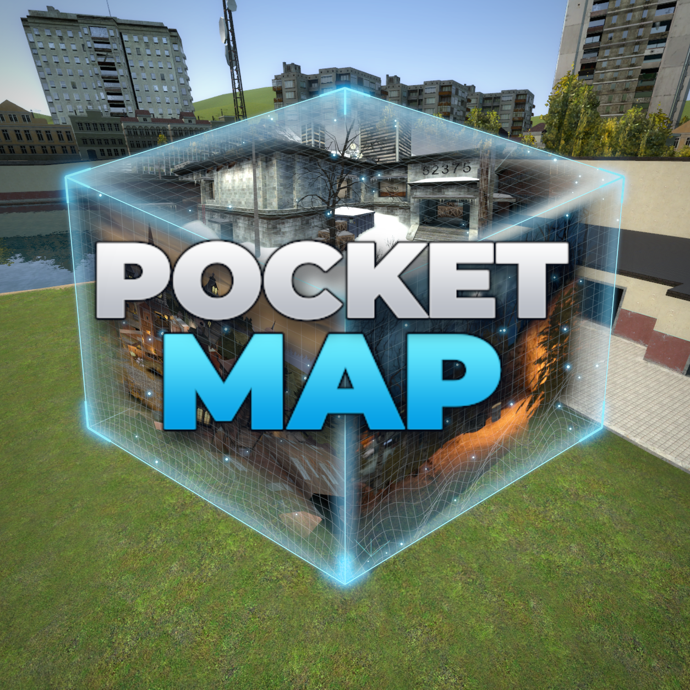

  

<h1 align="center">PocketMap</h1>

  A pocket-sized map viewer for Garry's Mod, and a proof of concept for what <a href="https://github.com/Nak2/NikNaks">NikNaks</a> can read out of a <code>.bsp</code>.

---

## What is this?

PocketMap adds one entity, a glass block called **Pocket Map**. Press <kbd>E</kbd> on it, pick an installed map, and the map is rebuilt at runtime on the client as a tiny version of itself inside the block. You can walk up to it, or step inside.

Nothing is pre-made: no models, no exported meshes, no map-specific code. It is all drawn from the data NikNaks parses out of the `.bsp`: world geometry, baked lighting, props, grass, sky and water.

> [!WARNING]
> This is a proof of concept and **will have bugs**. It is only a **renderer**: no entity logic is parsed, so doors, buttons, triggers and lights don't work. Maps are shown as a static picture.

## Requirements

- [NikNaks](https://github.com/Nak2/NikNaks) 0.97 or newer
- The map installed on every client that should see it (others see a red hologram)

## What data can you get from a map?

| What | NikNaks |
| --- | --- |
| The map | `NikNaks.Map( name )` |
| Faces, planes, vertices, brush models | `bsp:GetFaces()`, `GetPlanes()`, `GetVertex()`, `GetBModels()` |
| Texture, world or brush entity, tool textures | `face:GetTexture()`, `IsWorld()`, `ShouldRender()`, `GetEntity()` |
| Displacements (terrain) | `bsp:GetDispInfo()`, `GetDispVerts()` |
| Drawable meshes | `NikNaks.MeshBuilder()` |
| Baked lighting and light styles | `bsp:CreateLightmapAtlas()` |
| Every entity as key-values | `bsp:GetEntities()` |
| Static props | `bsp:GetStaticProps()` |
| Grass and plants | `bsp:GetDetailPropInfo()`, `GetDetailProp()` |
| Ambient light of a spot, sun | `leaf:CalculateAmbientCube()`, `bsp:GetWorldLights()` |
| 3D skybox | `bsp:GetSkyBoxPos()`, `GetSkyBoxScale()`, `GetSkyboxLeafs()` |
| Open space of the map | `bsp:GetLeafs()`, `PointInLeaf()` |
| Rays against the map | `bsp:SurfaceTraceLine()` |

## Settings

To walk through a loaded map, aim at its block and run `pocketmap_walk` in the console. Use WASD, Space to jump, Shift to run, and Ctrl to crouch. Your noclip key (default V) or `pocketmap_noclip` toggles Source-style flight through walls: look to steer, Space to rise, Shift for faster flight, and Ctrl for slower flight. Run `pocketmap_walk` again to return to your player. This moves a local camera through the map from a clear player spawn; your player remains in the main world. Movement uses BSP brush collision and water contents. Props, displacement terrain, and moving brush entities do not have dedicated collision in this mode.

Walk mode reads the running server's movement convars, including `sv_airaccelerate`, and the player's movement speeds, jump power, and gravity. Custom gamemode movement hooks are not automatically simulated inside the miniature.

| ConVar | Default | |
| --- | --- | --- |
| `pocketmap_propmeshes` | `1` | Bake models into the map instead of one `ClientsideModel` per prop |
| `pocketmap_lighttoggle` | `1` | Include switchable and animated light styles |
| `pocketmap_water` | `0` | Water reflects the tiny map (costly) |
| `pocketmap_maxmaps` | `5` | Most maps loaded at once (each uses up to 64 MB of video memory) |
| `pocketmap_adminonly` | `0` | Server: only admins can change a block's map |

`pocketmap_info` prints what every loaded block holds. The server only stores the map's name; each client builds the map itself.

## Reading the code

Each file in `lua/pocketmap` is one topic, so it doubles as an example of using NikNaks. Start with `cl_loader.lua`, which lists the stages that turn a `.bsp` into meshes.

## License

[CC0 1.0](LICENSE): use the code however you like, in any project, with no credit or notice required. If you find it useful and we meet some day, you can buy me a beer, but that's not required. (`cl_maplist.lua` is based on Facepunch's MIT-licensed `getmaplist.lua` and keeps its own notice.)
