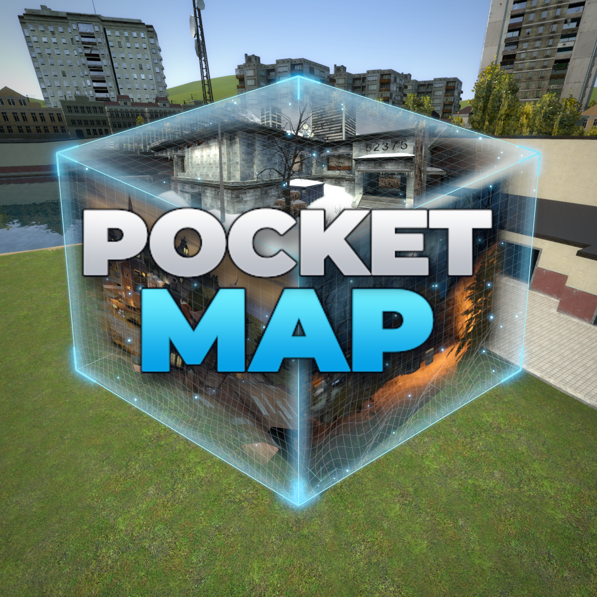

  

<h1 align="center">PocketMap</h1>

  Shrink any Garry's Mod map into a glass block, then step inside and walk around in it.

---

## What is this?

PocketMap adds one entity, a block called **Pocket Map**. Pick a map and it is rebuilt at runtime as a tiny version inside itself. You can noclip or press R to enter the map as a clientside walkable player.

It is a proof of concept for what [NikNaks](https://github.com/Nak2/NikNaks) can parse out of a `.bsp`.

> [!WARNING]
> This **will have bugs**. Common teleports, doors, buttons and movers are simulated on the client. Other map entity logic may behave differently from the original map.

## Features

- **Walk inside the map:** press <kbd>R</kbd> on the entity to teleport inside, and <kbd>R</kbd> again to leave. WASD, jump, run, crouch and ladders, with noclip key for flying around.
- **Mini you:** players near the block see your player model, animated, walking around inside it.
- **Real collision:** brushes, terrain, water and static props are solid, and ladders can be climbed.
- **Any map clients have installed:** pick one from a browsable map list. Server doesn't need to have the map installed.

## How to use it

Spawn the entity from the **Entities** tab of the spawn menu, under **Fun + Games**. Press <kbd>E</kbd> to open the **Maps** and **Performance** tabs. Choose a map and settings, then press **OK and Rebuild**. Once it has loaded, press <kbd>R</kbd> to walk in.

## Walking in a map

You start at a random player spawn of the map. Your noclip key (default V) or `pocketmap_noclip` toggles flight, and flying out of the block ends the walk. Your camera moves through the map and your real player stays in the main world.

- **Collision:** brushes, displacements, ladders, water and static props (from their `.phy` files).
- **Respawning:** dying during a walk keeps you in the miniature. When your player respawns, you restart at a clear map spawn inside the same block.
- **Movement:** it reads the server's movement ConVars, such as `sv_airaccelerate`, and runs the gamemode's `SetupMove`, `Move` and `FinishMove` hooks, including Sandbox's jump boost. (Clientside)
- **Other players:** your position, angles and velocity are sent to the server, which relays them to players near it. They will see a tiny version of you within the map.

## Requirements

- [NikNaks](https://github.com/Nak2/NikNaks) 0.99 or newer (the matching changes are proposed in [NikNaks #24](https://github.com/Nak2/NikNaks/pull/24); not yet an upstream release)

Update both add-ons together and restart after updating NikNaks. The 0.99 dependency includes directional lightmap coordinates, native lightmap color conversion, material binding callbacks, and linear ambient irradiance. An older library can accept the extra Lua arguments while silently rendering different results.

## Supported map I/O

Map I/O runs in source-map coordinates, separately for each walk. Outputs preserve their Hammer parameters, caller, activator, delays and fire limits. Due outputs run in chronological order, with stable ties and a limit on zero-delay chains. Respawning preserves the current map logic; starting a new walk creates a new session.

| Entity | Supported behavior |
| --- | --- |
| `trigger_teleport` | Enabled/disabled triggers, convex brush overlap, named destinations, output wiring |
| `func_door`, `func_door_rotating`, `prop_door_rotating` | Initial poses, opening/closing, locking, configured rotation axes, touch/use flags and endpoint outputs |
| `func_button`, `func_rot_button` | Touch/use activation flags, locking, toggle/return behavior and outputs |
| `momentary_rot_button` | Initial position and explicit position inputs; continuous held-use behavior is not emulated |
| `func_movelinear` | Authored start fraction, movement to a fraction, speed, opening/closing and endpoint outputs |
| `func_train`, `func_tracktrain` | Named paths, forward/reverse travel, stopping/resuming and path outputs; basic translation carries grounded passengers |
| `func_conveyor` | Configured-hull ground contact, speed and enable/disable controls |
| `logic_relay`, `logic_auto` | Trigger forwarding and fresh-session `OnMapSpawn`/`OnNewGame` outputs |

These are clientside simulations, not a replacement for Source's entity system. Filters, parenting, NPC/physics interaction, crushing, curved/oriented train motion, native player inputs, button damage activation and runtime light inputs are not emulated. Named and animated light styles retain their authored lighting behavior. Adding a newly dynamic entity class requires rebuilding the miniature's meshes.

## NikNaks functions used

| What | NikNaks |
| --- | --- |
| The map | `NikNaks.Map( name )` |
| Faces, planes, vertices, brush models | `bsp:GetFaces()`, `GetPlanes()`, `GetVertex()`, `GetBModels()` |
| Texture, world or brush entity, tool textures | `face:GetTexture()`, `IsWorld()`, `ShouldRender()`, `GetEntity()` |
| Displacements (terrain) | `bsp:GetDispInfo()`, `GetDispVerts()` |
| Drawable meshes | `NikNaks.MeshBuilder()` |
| Baked lighting and light styles | `bsp:CreateLightmapAtlas()` |
| Every entity as key-values, Hammer outputs | `bsp:GetEntities()`, `NikNaks.EntityValue()`, `NikNaks.ParseEntityOutput()` |
| Brush-model collision | `bmodel:GetBrushes()` |
| Visibility membership and triangle bounds | `bsp:GetFaceClusters()`, `NikNaks.MeshBuilder( true )`, `mesh:GetBounds()` |
| Static props | `bsp:GetStaticProps()` |
| Collision of a prop model | `NikNaks.Physics.Load( model )` |
| Grass and plants | `bsp:GetDetailPropInfo()`, `GetDetailProp()` |
| Ambient light of a spot, sun | `leaf:CalculateAmbientCube()`, `bsp:GetWorldLights()` |
| 3D skybox | `bsp:GetSkyBoxPos()`, `GetSkyBoxScale()`, `GetSkyboxLeafs()` |
| Open space of the map | `bsp:GetLeafs()`, `PointInLeaf()` |
| Rays against the map | `bsp:SurfaceTraceLine()`, `SurfaceTraceBlocked()` |

## Settings

The Performance tab has **61 independent checkboxes**, grouped by water, geometry, lighting, effects, optimizations and collision. Each option shows its cost or benefit and visual importance; hover it for details. **Performance**, **Balanced**, and **High Fidelity** fill in the checkboxes, which you can then adjust individually. Edits and map selections stay pending until **OK and Rebuild**; Cancel discards them.

Settings are clientside snapshots for each block. Applying settings also saves your defaults for new blocks; other already loaded blocks keep their settings. Performance and Balanced avoid the additional world-depth alignment draw unless the flashlight needs it. High Fidelity retains it and enables the visual features. Conservative culling and caching stay enabled in all three presets. Occlusion requires the complete object bounds to lie behind one opaque convex BSP face; transparent, cutout, displaced and uncertain surfaces remain visible.

**Minimal outside preview**, under Optimizations, is enabled in all three presets. Outside the block, only opaque world geometry with simple fullbright textures is drawn. Props, water, skyboxes, glass, decals, lighting, effects and other players are hidden. Entering with the camera restores that block's selected features immediately; leaving returns to the minimal preview. The interior's assets are still built once during loading, so switching views requires no rebuild. Turn the option off to show the ordinary preview outside.

| ConVar | Default | |
| --- | --- | --- |
| `pocketmap_propmeshes` | `1` | Bake models into the map instead of one `ClientsideModel` per prop |
| `pocketmap_lighttoggle` | `1` | Include switchable and animated light styles |
| `pocketmap_water` | `1` | Legacy water control: 0 flat, 1 budgeted scenes, 2 full-rate scenes; the menu separates reflection and refraction |
| `pocketmap_minimal_preview` | `1` | Use the minimal outside preview; captured in each block's settings on rebuild |
| `pocketmap_maxmaps` | `5` | Most maps loaded at once (each uses up to 64 MB of video memory) |
| `pocketmap_adminonly` | `0` | Server: only admins can change a block's map |

Console commands: `pocketmap_walk` and `pocketmap_noclip`.

While walking, the flashlight uses Source's projected light and shadow rendering, scaled to the miniature with the regular flashlight settings and toggle.

For visual debugging, `pocketmap_compare` switches between a walking PocketMap and the actual map at the same eye position and viewing angle. Both maps must match. Run it again to return; the native comparison uses noclip to hold the viewpoint. This requires admin access or a session grant from the server (`ply.PocketMapCanCompare = true`).

## License

[CC0 1.0](LICENSE): use the code however you like, in any project, with no credit or notice required. If you find it useful and we meet some day, you can buy me a beer, but that's not required. (`cl_maplist.lua` is based on Facepunch's MIT-licensed `getmaplist.lua` and keeps its own notice.)
